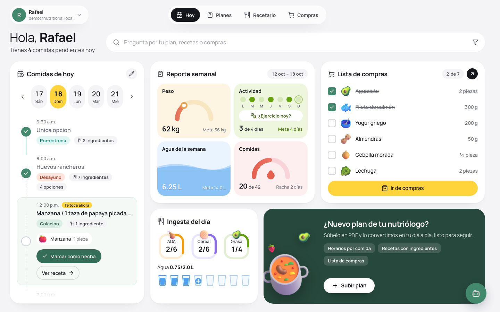
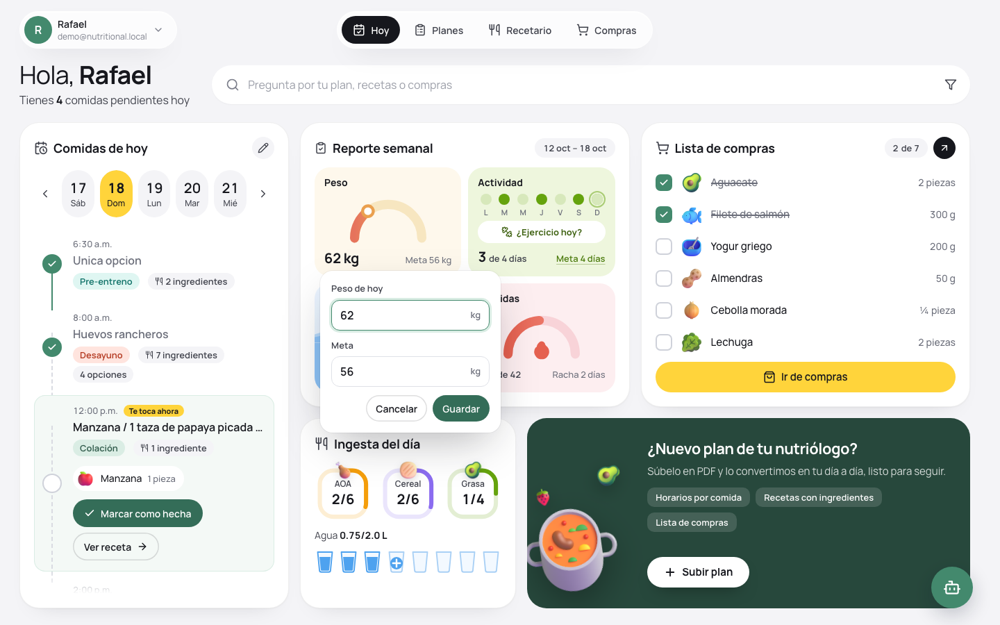
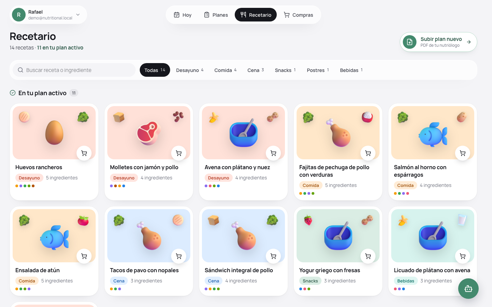
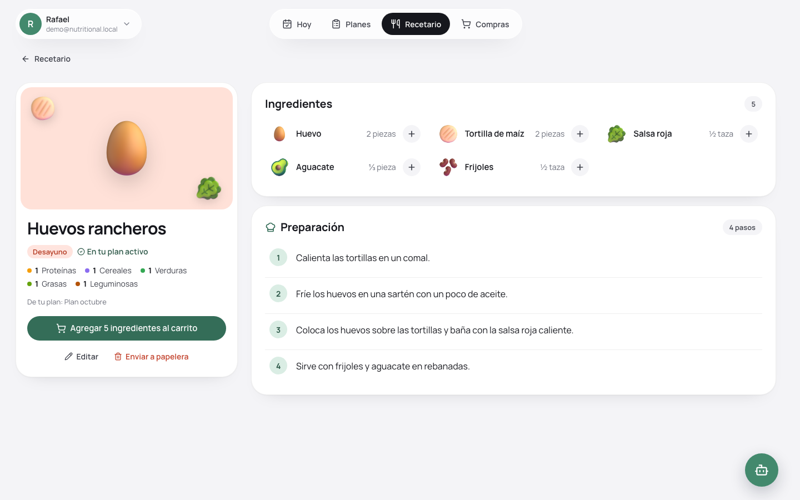
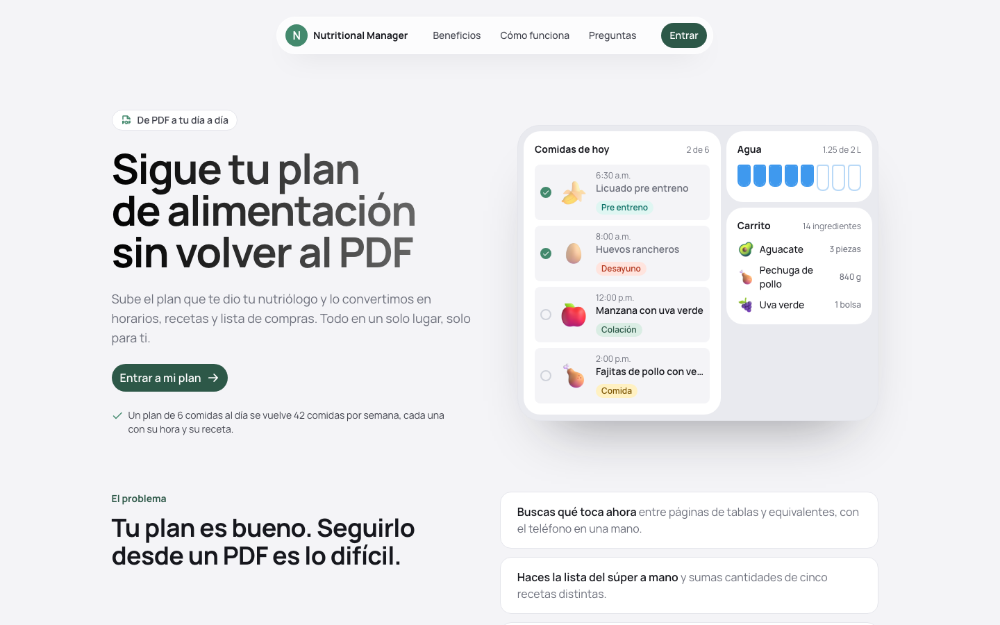
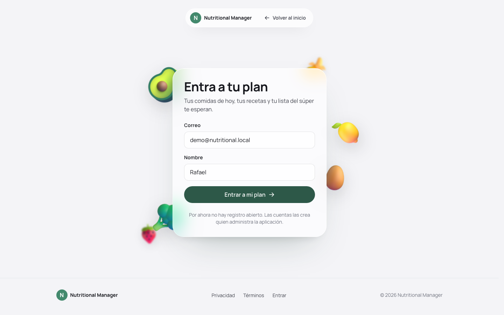
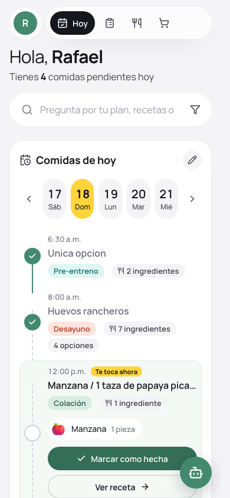
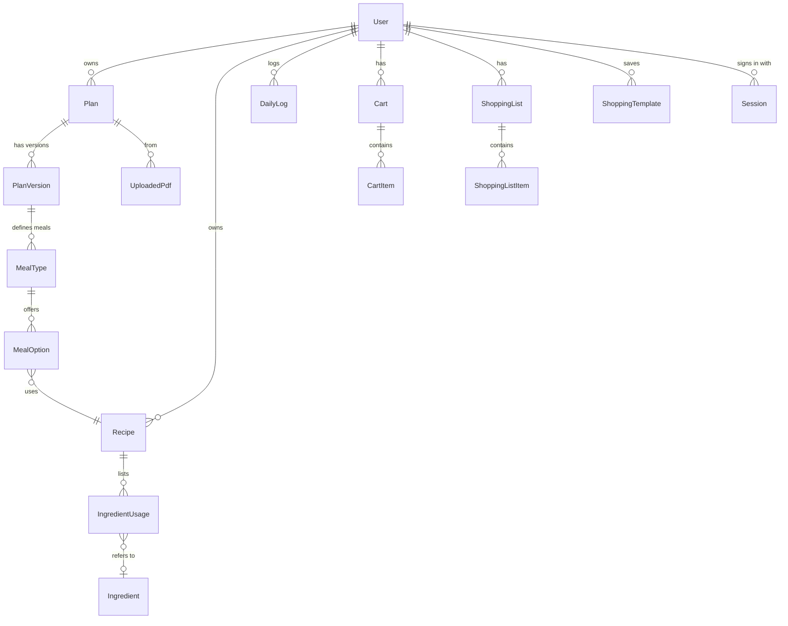

# Nutritional Manager

**Turn your nutritionist's PDF plan into a day you can actually follow:** a meal schedule, a recipe book and a shopping list, plus water, weight and activity tracking.



> The app's interface is in Spanish (Mexico). Screenshots use sample data.

## Contents

- [About](#about)
- [Features](#features)
- [Screenshots](#screenshots)
- [Tech stack](#tech-stack)
- [Project structure](#project-structure)
- [Data model](#data-model)
- [Getting started](#getting-started)
- [Scripts](#scripts)
- [Testing](#testing)
- [Deployment](#deployment)
- [Next steps](#next-steps)
- [Security notes](#security-notes)
- [Contributing](#contributing)
- [License](#license)

## About

Nutritionists usually hand out plans as PDFs: tables of meals, options and food-group "equivalents". Following one from a phone means scrolling through pages to find what's next and adding up ingredients by hand for the grocery run.

Nutritional Manager reads the PDF once and turns it into:

- **A daily schedule** with each meal at its time, checked off as you eat it.
- **A recipe book** built from every meal option in the plan, with ingredients and amounts.
- **A shopping list** that sums ingredients across the days you plan to cover.

It's a personal, self-hosted app: your plan and logs live in your own Postgres database.

## Features

**Today (home)**
- Meal timeline per day: check meals off, edit meal times, undo from a toast.
- The next meal opens up with its ingredients and a "Marcar como hecha" action.
- Daily intake rings per food group (from the plan's equivalents) and water glasses.
- Weekly report: weight with goal, exercise days with a weekly goal, weekly water and meals completed, with a streak.
- Shopping list with checkboxes (falls back to the cart when there's no list yet).
- Search bar that sends questions to the in-app assistant, scoped to the plan, the recipes or the cart.
- Fits one screen on desktop (1360×860 and up); stacks on tablets and phones.

**Plans**
- Upload a PDF; a review wizard shows every detected field before anything is saved.
- Multiple plans with versions; one active plan drives the schedule.

**Recipe book (Recetario)**
- Search by recipe or ingredient, filter by meal type.
- Recipe page with ingredients (add one or all to the cart), food groups and steps; edit or send to trash.

**Groceries (Compras)**
- Plan a period, consolidate ingredients into a cart, generate lists, and save frequent lists as templates.

**Assistant**
- Answers questions about your plan, recipes and cart using your own data only. It runs inside the app and sends nothing to external AI services.

**Everything else**
- Public landing page, login, privacy and terms pages, a branded 404.
- Trash with restore for plans, recipes, lists and templates.
- Motion that respects `prefers-reduced-motion`, plus reduced-transparency and high-contrast support.

## Screenshots

| Home | Weight and goal popover |
| --- | --- |
|  |  |

| Recipe book | Recipe page |
| --- | --- |
|  |  |

| Landing page | Login |
| --- | --- |
|  |  |

<p align="center"></p>

## Tech stack

| Area | Choice |
| --- | --- |
| Framework | [Next.js 15](https://nextjs.org) (App Router, Server Components, React 19) |
| Language | TypeScript |
| Database | PostgreSQL via [Prisma 7](https://www.prisma.io) with the `pg` driver adapter |
| PDF parsing | [unpdf](https://github.com/unjs/unpdf) |
| Validation | [Zod](https://zod.dev) |
| Styling | Plain CSS per feature, Tailwind CSS v4 and shadcn/ui primitives, Manrope font |
| Icons and art | Lucide, Phosphor, Microsoft Fluent 3D emoji (food illustrations) |
| Notifications | [Sonner](https://sonner.emilkowal.ski) |
| Testing | [Playwright Test](https://playwright.dev) end-to-end suite |

## Project structure

```
prisma/                 Schema and migrations
public/food/            Food illustrations (Fluent emoji, MIT)
src/
  app/                  Routes: (dashboard) pages, api/ route handlers, landing, login, legal
  components/           UI by feature: dashboard, recipes, groceries, plans, landing, auth, app shell
  lib/
    domain/             Plan parsing, recipes, cart, queries, assistant answers
    storage/            Prisma client and loaders
    validation/         Zod schemas for every API input
  middleware.ts         Shows the landing page to signed-out visitors on "/"
tests/e2e/              Playwright suite (clones the database for each run)
```

## Data model

Every table has a `seq` column for stable ordering and soft deletes (`deleted_at`) where items can go to the trash. The core relationships:



| Model | What it stores |
| --- | --- |
| `User` | Account, plus weekly goals (`weight_goal_kg`, `activity_goal_days`) |
| `Plan` / `PlanVersion` | A nutrition plan and its versions; `structured_data` (JSON) keeps what was read from the PDF |
| `MealType` / `MealOption` | The plan's meals (Desayuno, Comida…) with their time, and the recipe options for each |
| `Recipe` / `IngredientUsage` / `Ingredient` | Recipes, their ingredient lines and the canonical ingredient catalog |
| `DailyLog` | One row per user and day: meals done, water glasses, weight, exercised |
| `Cart` / `CartItem` | Ingredients collected for an upcoming shopping trip |
| `ShoppingList` / `ShoppingListItem` | Generated lists with a status per item (Pendiente, Comprado…) |
| `ShoppingTemplate` | Saved, reusable lists |

The full schema lives in [`prisma/schema.prisma`](prisma/schema.prisma).

## Getting started

### Prerequisites

- Node.js 20 or later
- PostgreSQL 14 or later
- `psql` and `pg_dump` on your `PATH` (only for the e2e tests)

### Setup

```bash
git clone https://github.com/rafaelMMGH/nutritional-manager.git
cd nutritional-manager
npm install
```

`npm install` also generates the Prisma client. Create the database and point the app at it in `.env.local`:

```bash
createdb nutritional-manager
echo 'DATABASE_URL="postgresql://localhost:5432/nutritional-manager"' > .env.local
```

Apply the migrations and start the dev server:

```bash
npx prisma migrate deploy
npm run dev
```

Open http://localhost:3000. The first sign-in creates the demo account; the login form comes prefilled. Then upload your nutritionist's PDF from the home page.

### Environment variables

| Variable | Required | Description |
| --- | --- | --- |
| `DATABASE_URL` | Yes | PostgreSQL connection string |
| `NEXT_DIST_DIR` | No | Build folder; the e2e suite sets it to `.next-e2e` so it never shares `.next` with your dev server |

## Scripts

| Command | What it does |
| --- | --- |
| `npm run dev` | Start the dev server on :3000 |
| `npm run build` / `npm start` | Production build and server |
| `npm run db:migrate` | Create and apply a new migration (development) |
| `npm run db:generate` | Regenerate the Prisma client |
| `npm run db:studio` | Browse the database in Prisma Studio |
| `npm run db:import` | Import a legacy `data/db.json` into Postgres |
| `npm run test:e2e` | Run the Playwright suite |
| `npm run test:e2e:report` | Open the last test report |

## Testing

```bash
npm run test:e2e
```

The suite never touches your data:

1. It clones your database into `<name>-e2e`.
2. It starts its own `next dev` on port 3200, pointed at the copy.
3. It signs in through the real login form.
4. It drops the copy when the run ends.

It covers the home dashboard end to end. Each change is checked on screen, after a reload, and in the database:

- **Meals:** checking off, undo, edited times.
- **Days:** past and future days, the day strip.
- **Tracking:** water, exercise, weight and goals.
- **Shopping:** the list check-off.
- **Search:** the assistant answers questions from the search bar.

Any console error or failed API call fails the test that caused it.

## Deployment

The app runs anywhere that hosts Next.js with a PostgreSQL database, for example [Vercel](https://vercel.com) with a managed Postgres (Neon, Supabase and others from the Vercel Marketplace):

1. Create the database and set `DATABASE_URL` in the project's environment variables.
2. Run `npx prisma migrate deploy` against it, either once or as part of the build.
3. Deploy. The build runs `prisma generate` through `postinstall`.

Before deploying publicly, read the [security notes](#security-notes). Also note that uploaded PDFs are saved to the local `data/private-pdfs` folder, which doesn't persist on serverless platforms. Move them to object storage, for example Vercel Blob or S3, first.

## Next steps

- [ ] Real authentication: passwords (or a provider), per-user accounts instead of the single demo user.
- [ ] Store uploaded PDFs in object storage instead of the local filesystem.
- [ ] Improve PDF reading: plural units ("3 piezas"), scanned PDFs via OCR.
- [ ] Redesign the Planes and Compras pages to match the new home and recipe book.
- [ ] Dark mode.
- [ ] Unit tests for the plan parser and cart consolidation; run the e2e suite in CI.
- [ ] Choose and add a license.

## Security notes

The current login is a **local demo**: it doesn't ask for a password, and it signs everyone into the first account. That's fine on your own machine. Don't expose the app to the internet until real authentication is in place (see [Next steps](#next-steps)).

Never commit `.env.local` or the `data/` folder. They hold your database credentials, plan PDFs and personal data, and both are in `.gitignore`.

## Contributing

Issues and pull requests are welcome. Before opening a PR:

1. Run `npx tsc --noEmit` and `npm run test:e2e`.
2. Keep UI copy in Spanish.
3. Add a migration (`npm run db:migrate`) for any schema change.

## License

No license has been chosen yet, so all rights are reserved by default. The food illustrations in `public/food` are [Microsoft Fluent Emoji](https://github.com/microsoft/fluentui-emoji) under the MIT License (see [`public/food/LICENSE`](public/food/LICENSE)).
